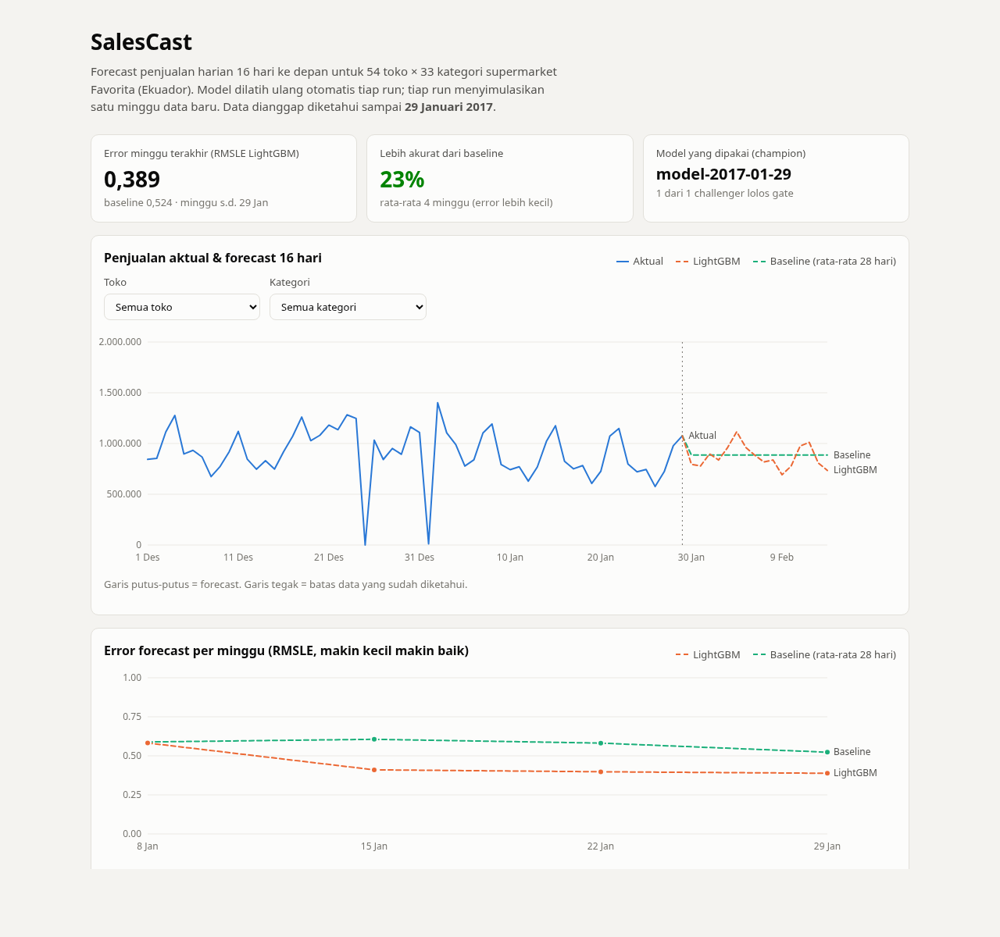

# SalesCast

[](https://github.com/SulthanAndyno/salescast/actions/workflows/ci.yml)
[](https://github.com/SulthanAndyno/salescast/actions/workflows/retrain.yml)
[](https://sulthanandyno.github.io/salescast/)

Proyek forecasting penjualan harian untuk jaringan supermarket Favorita di Ekuador. Model memprediksi penjualan
16 hari ke depan untuk 54 toko x 33 kategori produk (1.782 deret waktu sekaligus), lalu dilatih ulang secara otomatis
di GitHub Actions setiap ada "data minggu baru".

Fokus proyek ini bukan cuma modelnya, tapi juga alur setelah model jadi: bagaimana model baru diuji sebelum dipakai,
disimpan berversi, bisa di-rollback, dipantau akurasinya dari minggu ke minggu, dan memberi tahu kalau ada yang aneh.
Semuanya jalan gratis di GitHub Actions dan GitHub Pages.

Dashboard: https://sulthanandyno.github.io/salescast/



## Daftar isi

- [Data](#data)
- [Hasil](#hasil)
- [Cara kerja](#cara-kerja)
- [Workflow GitHub Actions](#workflow-github-actions)
- [Hal yang saya temukan selama pengerjaan](#hal-yang-saya-temukan-selama-pengerjaan)
- [Batasan](#batasan)
- [Menjalankan di lokal](#menjalankan-di-lokal)
- [Struktur repo](#struktur-repo)

## Data

Dataset dari kompetisi Kaggle [Store Sales - Time Series Forecasting](https://www.kaggle.com/competitions/store-sales-time-series-forecasting).

| File | Isi | Ukuran |
|---|---|---|
| `train.csv` | penjualan harian per toko dan kategori, 1 Jan 2013 s.d. 15 Agu 2017 | 3.000.888 baris |
| `stores.csv` | kota, provinsi, tipe, dan cluster tiap toko | 54 baris |
| `holidays_events.csv` | hari libur nasional, regional, lokal, dan event | 350 baris |
| `oil.csv` | harga minyak harian (ekonomi Ekuador sangat bergantung pada minyak) | 1.218 baris |
| `transactions.csv` | jumlah transaksi per toko per hari | 83.488 baris |

Data tidak disimpan di repo karena terikat aturan kompetisi. Workflow mengunduhnya lewat Kaggle API lalu menyimpannya
di cache Actions.

Metrik yang dipakai adalah RMSLE, sama seperti di kompetisinya. Metrik ini menilai kesalahan relatif, jadi meleset
10 unit di produk yang lakunya 20 dianggap lebih parah daripada meleset 10 unit di produk yang lakunya 2.000.
Makin kecil makin baik.

## Hasil

Backtest dengan 6 titik potong mingguan (11 Nov s.d. 16 Des 2016). Di setiap titik potong, model hanya boleh
melihat data sebelum tanggal itu lalu memprediksi 16 hari berikutnya.

| Model | RMSLE rata-rata |
|---|---|
| Seasonal naive (penjualan hari yang sama minggu lalu) | 0,680 |
| Rata-rata 28 hari terakhir | 0,610 |
| LightGBM | 0,528 |

LightGBM lebih baik di keenam titik potong.

Selama simulasi berjalan, forecast setiap minggu dinilai ulang saat data aktualnya sudah "terungkap". Angka ini lebih
jujur daripada backtest karena memakai model yang benar-benar dipakai saat itu. Angka terbaru ada di dashboard.

| Minggu s.d. | LightGBM | Rata-rata 28 hari |
|---|---|---|
| 8 Jan 2017 | 0,583 | 0,589 |
| 15 Jan 2017 | 0,410 | 0,606 |
| 22 Jan 2017 | 0,398 | 0,582 |
| 29 Jan 2017 | 0,389 | 0,524 |

Kalau dipecah per kategori (holdout 14 s.d. 29 Jan 2017), kategori yang volumenya besar dan stabil paling mudah
diprediksi, misalnya HOME CARE dan PRODUCE (0,17) serta DAIRY (0,18). Yang paling susah adalah kategori kecil yang
sering tidak laku sama sekali, seperti LINGERIE (0,63), GROCERY II (0,58), dan CELEBRATION (0,57). Selisih paling jauh
dari baseline ada di FROZEN FOODS (0,36 lawan 1,63) dan LIQUOR,WINE,BEER (0,50 lawan 1,11), karena rata-rata 28 hari
ikut membawa lonjakan belanja Desember ke bulan Januari.

## Cara kerja

### Simulasi data baru

Data aslinya berhenti di 15 Agustus 2017, jadi tidak ada data baru yang benar-benar masuk. Untuk menguji pipeline
retrain, saya pakai file `data/cursor.txt` yang berisi tanggal "hari ini". Semua data setelah tanggal itu dianggap
belum ada. Simulasi dimulai dari 1 Januari 2017, dan setiap kali workflow retrain jalan, kursor maju 7 hari. Dari
Januari sampai Agustus ada sekitar 31 langkah.

### Model

Satu model LightGBM dipakai untuk semua 1.782 deret sekaligus. Targetnya `log1p(sales)`, sehingga loss L2 biasa
sama dengan mengoptimalkan RMSLE.

Supaya satu model bisa langsung memprediksi hari ke-1 sampai ke-16 tanpa menebak berantai, semua fitur penjualan
hanya memakai data minimal 16 hari sebelum tanggal yang diprediksi:

- lag 16, 21, 28, 35, 42, dan 364 hari (21 sampai 42 jatuh di hari yang sama dalam minggu, 364 = tahun lalu)
- rata-rata 7, 14, 28, 56 hari dan standar deviasi 28 hari, semuanya digeser 16 hari
- tanggal, hari dalam minggu, bulan, dan hari gajian (tanggal 15 dan akhir bulan untuk pegawai negeri Ekuador)
- libur nasional, serta libur regional/lokal yang dicocokkan ke kota dan provinsi tiap toko
- jumlah produk yang sedang promo
- harga minyak, juga digeser 16 hari
- tipe dan cluster toko

Ada test yang memastikan tidak ada kebocoran data: semua penjualan setelah tanggal t diganti 9999, lalu fitur sampai
tanggal t+16 harus tetap sama persis (`tests/test_features.py`).

### Gate sebelum model dipakai

Setiap run melatih model baru (challenger) dengan data sampai 16 hari sebelum kursor. Lalu challenger, model yang
sedang dipakai (champion), dan baseline rata-rata 28 hari diuji di 16 hari terakhir itu. Karena champion juga dilatih
sebelum periode tersebut, ketiganya sama-sama belum pernah melihat data uji.

Challenger menggantikan champion kalau RMSLE-nya tidak lebih buruk dari champion dan setidaknya 5% lebih baik dari
baseline. Kalau tidak lolos, champion lama tetap dipakai untuk forecast.

Model yang lolos tidak dilatih ulang dengan 16 hari terakhir. Fiturnya tetap dihitung dari data terbaru saat
prediksi, jadi yang hilang hanya 16 hari contoh training. Dengan cara ini perbandingan di gate tetap adil.

### Registry dan rollback

Setiap model yang lolos gate disimpan sebagai GitHub Release dengan nama `model-<tanggal kursor>`, isinya file model
LightGBM sekitar 7 MB dan skor holdout-nya. File `reports/champion.json` menunjuk versi mana yang sedang dipakai.

Untuk rollback: buka Actions, pilih workflow retrain, klik Run workflow, lalu isi `rollback_to` dengan versi lama dari
halaman Releases.

### Monitoring dan alert

Setiap minggu, forecast minggu sebelumnya dinilai dengan data aktual yang baru terungkap, lalu dicatat di
`reports/metrics.jsonl`. Kalau error minggu itu lebih dari 1,5 kali median 8 minggu sebelumnya, workflow membuka
GitHub Issue berisi angka error, link dashboard, dan langkah rollback.

## Workflow GitHub Actions

| Workflow | Kapan jalan | Isinya |
|---|---|---|
| `ci.yml` | setiap push dan pull request | ruff (lint + format) dan pytest |
| `retrain.yml` | setiap hari 08.00 WIB, atau manual | majukan kursor, nilai forecast lama, latih challenger, gate, rilis model, forecast baru, alert, commit hasil |
| `pages.yml` | setelah retrain selesai, atau saat `site/` berubah | buat `data.json` lalu deploy dashboard ke GitHub Pages |

Secret yang perlu diisi hanya `KAGGLE_API_TOKEN`. Release, Issue, dan Pages memakai token bawaan GitHub Actions.

## Hal yang saya temukan selama pengerjaan

### Data yang hilang terbaca sebagai nol

Di minggu pertama simulasi, LightGBM malah kalah jauh dari baseline (RMSLE 1,05 lawan 0,59), padahal di backtest
selalu menang. Setelah saya cek per kategori, error-nya menumpuk di PRODUCE dan HOME CARE. Model memprediksi angka
mendekati 0, padahal penjualan aslinya ribuan.

Ternyata antara Februari 2014 dan Mei 2015, sekitar 10 kategori (PRODUCE, HOME CARE, CELEBRATION, LADIESWEAR,
PET SUPPLIES, dan lainnya) tercatat hampir 0 di ratusan hari. PRODUCE saja 300 hari. Ini data yang tidak tercatat,
bukan penjualan yang benar-benar turun. Jendela training 2 tahun ikut memuat Januari sampai Mei 2015, jadi model
belajar pola yang salah: setiap Januari, kategori-kategori ini anjlok.

Perbaikannya ada di `features.gaps()`. Kalau total penjualan nasional sebuah kategori di satu hari kurang dari 1%
dari rekor sebelumnya, hari itu dianggap data hilang dan dikeluarkan dari fitur maupun target training. Setelah itu
Januari 2017 jadi 0,51 lawan 0,61, dan PRODUCE serta HOME CARE berubah jadi kategori paling mudah diprediksi.

Backtest November sampai Desember tidak menangkap masalah ini. Monitoring mingguan yang menangkapnya.

### Hari toko tutup

Tanggal 25 Desember tidak ada di data sama sekali, dan total penjualan 1 Januari hampir nol (sekitar 12 ribu, padahal median hari biasa di Januari 2017 sekitar 790 ribu). Tanpa penanganan khusus,
RMSLE di titik potong Desember melonjak ke 1,3 sampai 1,7. Sekarang prediksi di dua tanggal itu langsung 0, dan
keduanya tidak dipakai sebagai fitur. Seasonal naive tetap rusak di minggu setelahnya karena menyalin angka 0 itu.

### Hal kecil lainnya

- Gempa 16 April 2016 membuat orang memborong barang untuk donasi selama beberapa minggu. Periode 16 April sampai
  15 Mei 2016 tidak dipakai sebagai target training.
- 31% nilai penjualan adalah 0. Deret yang 8 minggu tidak laku langsung diprediksi 0.

## Batasan

- Ini simulasi. "Data baru" sebenarnya data 2017 yang dibuka bertahap, dan retrain harian berarti satu minggu
  simulasi per hari supaya pipeline teruji puluhan kali dalam sebulan.
- Data promo untuk tanggal yang diprediksi diambil langsung dari dataset, dengan asumsi jadwal promo sudah diketahui
  sebelumnya (Kaggle juga memberikannya di `test.csv`).
- Backtest hanya 6 titik potong dan semuanya di musim akhir tahun. Angka realisasi di dashboard lebih representatif.
- Aturan 1% di atas juga menandai musim sepi yang memang nyata, misalnya SCHOOL AND OFFICE SUPPLIES di luar musim
  sekolah dan BOOKS sejak Mei 2017. Dampaknya belum saya ukur. Rencananya membedakan penurunan mendadak (data hilang)
  dari penurunan bertahap (musiman).
- Forecast masih berupa satu angka per hari, belum ada rentang ketidakpastian.

## Menjalankan di lokal

Butuh Python 3.12+ dan [uv](https://docs.astral.sh/uv/). Sebelum mengunduh data, terima dulu aturan kompetisi di
halaman Kaggle-nya, lalu buat API token di https://www.kaggle.com/settings.

```bash
uv sync
export KAGGLE_API_TOKEN=token_kamu
uv run python -m salescast.data download     # unduh data ke data/*.parquet
uv run pytest -q                             # test

uv run python -m salescast.backtest          # baseline
uv run python -m salescast.model             # backtest LightGBM, sekitar 4 menit
uv run python -m salescast.ct                # satu langkah simulasi (mengubah cursor.txt dan reports/)
uv run python -m salescast.export            # buat site/data.json
python -m http.server -d site                # buka http://localhost:8000
```

## Struktur repo

```
salescast/
  data.py       unduh data Kaggle, baca/majukan kursor
  backtest.py   RMSLE, baseline, backtest walk-forward
  features.py   fitur lag/rolling/kalender/libur, deteksi data hilang
  model.py      training dan prediksi LightGBM
  ct.py         satu langkah retrain: nilai, gate, forecast, rollback, alert
  export.py     data untuk dashboard
site/           dashboard statis (HTML + SVG, tanpa library)
reports/        metrik mingguan, forecast terbaru, penunjuk champion (di-commit oleh workflow)
tests/          pytest
```

Rencana pengerjaan per fase ada di [PLAN.md](PLAN.md).
